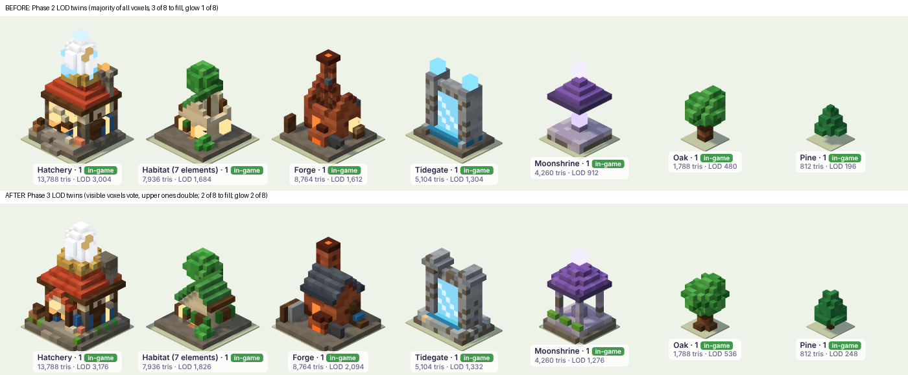
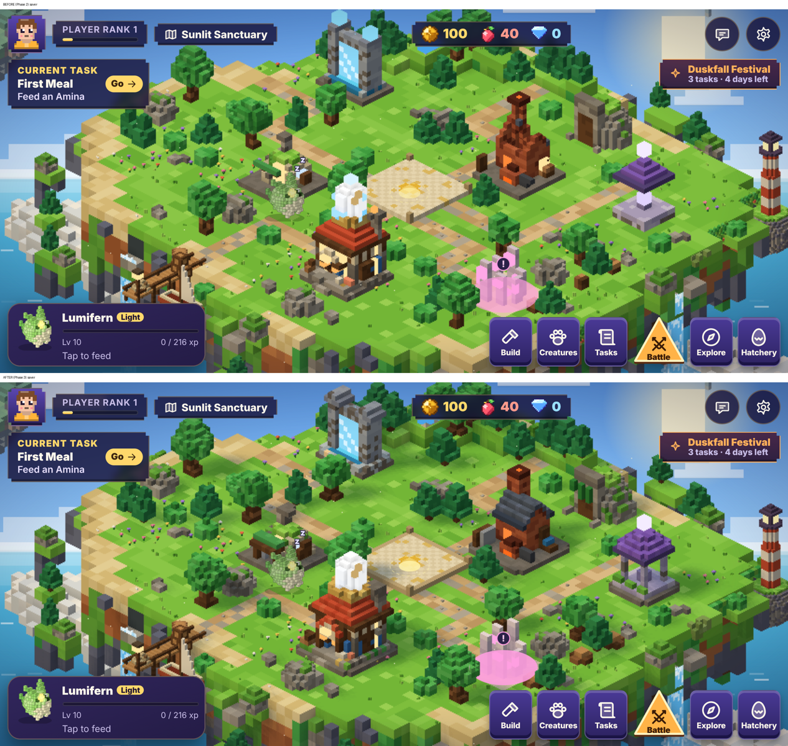
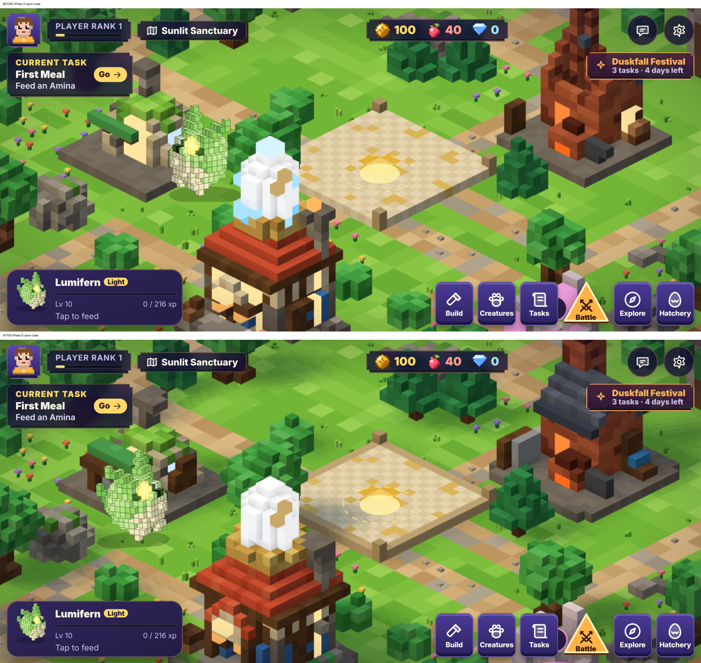
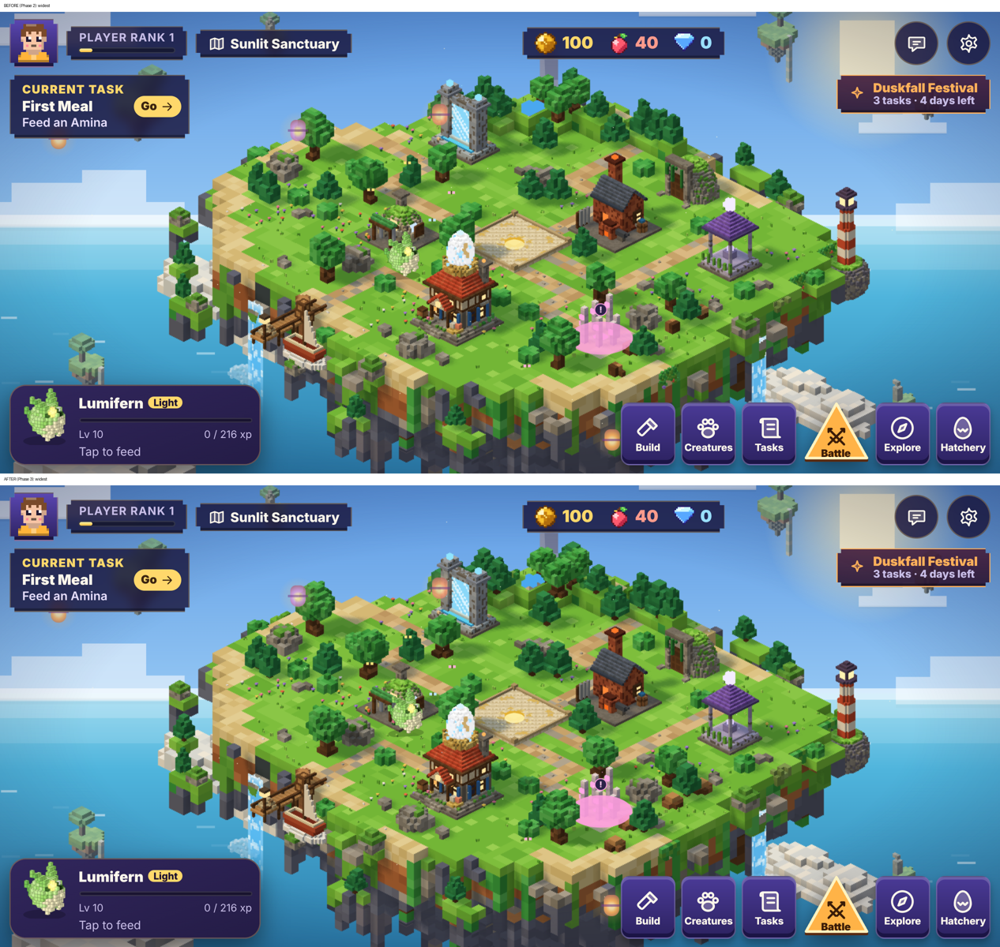
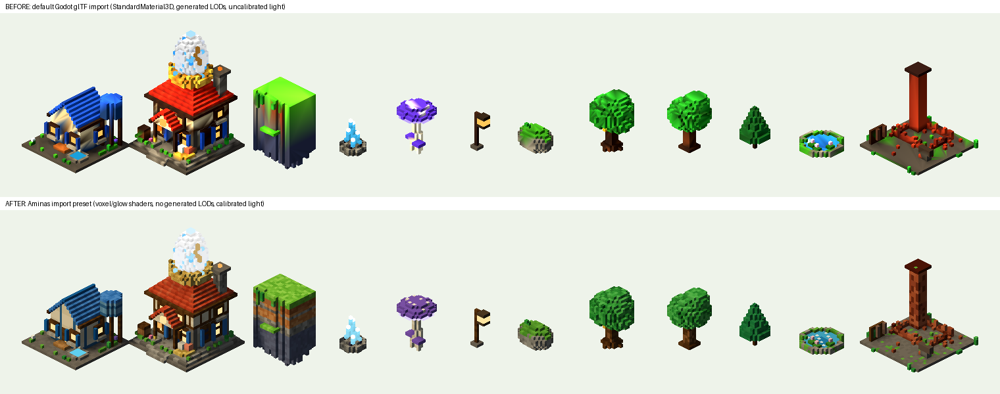

# Environment Phase 3: mobile performance, visual optimisation and asset pipeline validation

- **Branch:** `env3-mobile`, started from `e2dac52` (the head of `env2-art-library`). `main` and production are not
  touched.
- **Software actually used:**
  - Godot 4.3-stable (headless and under a virtual display; Compatibility renderer on a software GPU);
  - three.js, Playwright, Node.
- **Not used:** Meshy, Blockbench, MagicaVoxel and Figma were not operated.
- **Device testing:** the project owner ran the built-in test on an iPhone on 6 Nov 2026, including the 3-minute
  heat test. The phone has a 390 × 844 pt screen (iPhone 12, 13 or 14 class; A14–A15) and iOS 18.7, and the test ran
  in the Claude app. Results are in §1b and `perf/env3-iphone-1.json`. All other frame rates in this report come from
  Chromium with software WebGL on a desktop CPU and are only for before/after comparison.

## Status by priority

| # | Priority | Status |
|---|---|---|
| 1 | Real-device performance | **Measured on one iPhone (A14/A15 class): 60 fps in every case, island CPU about 2 ms, no thermal throttling.** Tool: Settings → Run performance test. |
| 2 | Visual optimisation | Battery saver improved: better building LOD twins, shadows kept. Quality tiers added. Lighting, vegetation and water are unchanged, pending device numbers (see "Decisions"). |
| 3 | Asset pipeline (Godot 4) | **Done and actually run.** 12 assets plus 12 LOD twins imported. Three compatibility problems found and fixed. The workflow is in `GODOT_PIPELINE.md`. |
| 4 | Performance standards | Tiers implemented. Auto now starts at High and steps down if needed. The measured row is filled for A14–A15; the A12–A13 and A16+ columns remain targets. |
| 5 | Project protection | Branch only. Gameplay, layouts and progression are unchanged. Save compatibility is tested. The full suite was run. |

## 1. The on-device performance test

`src/bench.js` adds **Settings → Run performance test**. The fixed script has 7 steps (about 40 s):

1. idle;
2. pan;
3. pan at the widest zoom;
4. pan at the closest zoom;
5. pan in High;
6. pan in Balanced;
7. pan in Battery saver.

An optional 3-minute sustained pan in 15 s slices serves as the heat test.

**For each step it records:**

- frame rate;
- p50, p95 and p99 frame times, the worst frame, and the share of frames over 33 ms;
- the island's CPU time per drawn frame;
- triangles, draw calls, pixel ratio, canvas size, shadow map size and LOD state.

**It also records:**

- the device: user agent, pixel ratio, screen, GPU string, cores;
- load timings: page loaded, 3D module loaded, island first shown;
- JS heap where the browser exposes it.

**It does not invent:**

- battery use (Safari has no Battery API);
- temperature (no thermal API);
- GPU time (no timer queries);
- memory on Safari.

These are reported as "not available". Thermal throttling shows up as frame-rate decline in the heat test.

**Results** appear in a sheet with a **Copy results** button (JSON plus a one-line summary). The last result is kept
in `localStorage` only. It is never written into the save.

## 1b. iPhone results (project owner's device)

| Step | Tier | fps | p95 ms | Island CPU ms | Triangles | Canvas px |
|---|---|---|---|---|---|---|
| idle | Balanced | 60 | 18 | 2.3 | 146k | 1125 × 468 |
| pan | Balanced | 60 | 17 | 1.8 | 147k | 1125 × 468 |
| pan, widest zoom | Balanced | 60 | 17 | 2.0 | 107k | 1125 × 468 |
| pan, closest zoom | Balanced | 60 | 17 | 1.4 | 118k | 1125 × 468 |
| pan, High | High | 60 | 17 | 2.2 | 147k | 1500 × 624 |
| pan, Balanced | Balanced | 60 | 17 | 2.2 | 147k | 1125 × 468 |
| pan, Battery saver | Battery saver | 60 | 17 | 1.9 | 82k | 750 × 312 |

**Heat test.** It held 60 fps for 3 minutes except one 15 s slice, which averaged 22.5 fps. In that same slice, 95 %
of frames still took 17 ms, and the next slices were back at 58–60 fps. That is the signature of a single
interruption (a notification, the app switcher, the screen dimming), not of heat: throttling raises every frame time
and does not recover in 15 s. The test reported this as a "16 % drop". It now counts intervals over 0.5 s as
interruptions, keeps them out of the frame rate and lists them separately.

**Loading.**

| Measure | Time |
|---|---|
| Page loaded | 1.24 s |
| Island 3D module (three.js and the island) | 0.77 s |
| Island shown, from the start of loading | 1.0 s |

The "since page start" figure (10.5 s) includes the time spent on the title screen, so it is not a load cost.

**What this means:**

- The island has a lot of CPU headroom: 2 ms of a 16.7 ms frame.
- Every case sat at the display cap, so the GPU margin is unknown. Even so, High, with 1.8 × the pixels of Balanced
  and a 4 × larger shadow map, showed no cost at all.
- **Decisions taken from these numbers:**
  1. **Auto now starts at High** and steps down to Balanced for the session only if camera frames run slow. A
     software-GL run confirms the step-down works. Phase 2's phone setting was Balanced.
  2. **Battery saver keeps its shadows.** They cost nothing measurable.
  3. **Battles stay at the Phase 2 resolution under Auto.** They were not measured. An explicit High raises them.
- **Not yet covered:**
  - full-screen Safari: about 1.4 × the pixels of the Claude viewer used here;
  - an older phone (A12–A13);
  - battles.

## 2. Bottleneck analysis

Same machine, software GL, 844 × 390 landscape, phone emulation (pixel ratio 3, touch). Raw files are
`perf/env3-before.json` and `perf/env3-after.json`.

| Evidence | Reading |
|---|---|
| Pan: 3.4 fps at pixel ratio 1.5 vs 9.5 fps at pixel ratio 1 (2.25 × fewer pixels, 2.8 × faster) | **Fill rate dominates.** |
| Pan at the widest zoom (125k triangles) vs normal zoom (170k) at the same pixel ratio: 3.1 vs 3.4 fps | **Triangle count is not the limit.** 27 % fewer triangles gave no gain. |
| 68–73 draw calls | Low. Not a limit. |
| Island CPU per drawn frame: 4–7 ms; occlusion pass 4–8 ms, at most about 9 times a second | CPU is fine for 60 fps if the GPU keeps up. |
| Terrain build 245–355 ms, object sync 150–290 ms | Once per visit or layout change, not per frame. They are the main part of the island's first-show time. |
| Idle main thread 14–56 ms per second (noisy, both before and after) | The still island costs almost nothing. |

- **Conclusion:** on a phone, the levers that matter are, in order:
  1. pixel ratio (resolution);
  2. shadow-map sampling;
  3. overdraw from transparent effects.

  Triangle trimming matters much less. That is why the tiers change resolution and shadows first, and why the art
  was not simplified to hit triangle numbers.
- **Untested:** this ordering comes from software GL. Apple's tile-based GPUs are usually fill-bound too, but the
  iPhone test will confirm or correct it.

## 3. Quality tiers

`A.Perf.TIERS` in `src/perf.js` holds the tiers. The island and the creature runtime both read them. Settings has a
new control, **3D detail: Auto / High / Balanced**. Battery saver stays a separate switch and overrides the tier.

| | High (Auto's starting tier) | Balanced | Battery saver |
|---|---|---|---|
| Pixel-ratio cap | 2 | 1.5 | 1 |
| Shadow map | 2048 | 1024 | 512 (was: no shadows) |
| LOD | nature at the widest zoom | nature at the widest zoom | everything, with improved twins |

- **Balanced reproduces Phase 2's phone settings exactly.**
- **Auto** started at Balanced on phones until the iPhone test; it now starts at High with an automatic step-down (§1b).
- **Saves:** the new `settings.quality` defaults to `auto`. Old saves without it, and invalid values, read as `auto`.
  This is tested.

## 4. Visual changes

### Better LOD twins

In Phase 2, each half-resolution block took the colour of the majority of its 8 voxels, hidden ones included, and
needed 3 of 8 voxels to exist. Thin roofs vanished and interiors showed through. Glow bloomed from a single voxel.

Now:

- **voxels the player can see** vote, and upper ones count double;
- a block needs 2 of 8 voxels;
- glow needs 2 of 8.

Results:

- the Forge keeps its slate roof and chimney;
- the Hatchery keeps its roof;
- the Moonshrine keeps its pillars.

Measured on top-face colour error against the full model:

| Building | Before | After |
|---|---|---|
| Forge | 0.056 | 0.010 |
| Hatchery | 0.044 | 0.006 |
| Moonshrine | 0.072 | 0.021 |
| Habitat | 0.024 | 0.033 (slightly worse) |

**The cost:** Battery saver draws **91k triangles instead of 88k (+3 %)**. Building twins go from 10.9k to 12.2k
triangles; nature twins from 17.2k to 18.8k.

### Battery saver keeps shadows

Shadows are re-rendered only when the island changes, so a 512 map costs little. Buildings and trees are grounded
again.

### Normal play is unchanged

At the default zoom in Balanced, the screenshots before and after differ only where ambient animation moved:
creatures, swaying leaves and motes (2.3 % of pixels).

### Decisions: what was deliberately not changed yet

Lighting, water, vegetation density and effects were not changed in this phase.

- The brief asks to find bottlenecks before optimising.
- The art of these systems was approved in Phases 1.2 and 2.

The analysis shows the costs are resolution and shadow sampling, not these systems. Any change to them should follow
the iPhone numbers. Examples:

- a cheaper water shader on A12–A13 if the test shows water-heavy views are slow;
- or the reverse: richer effects on High if A16 phones have headroom.

## 5. Godot 4 pipeline validation (actually run)

Full report: `GODOT_PIPELINE.md`. Renders and the JSON report are in `godot/`.

**Imported:** 12 assets.

| Category | Assets |
|---|---|
| Buildings | Hatchery, habitat |
| Ruin | Forge ruin |
| Terrain | cliff, mossy rock, crystals |
| Vegetation | oak, old oak, pine, glowcap |
| Decoration | lantern post |
| Water | pond |

Their 12 LOD twins were imported too.

**Checks passing on all 12:**

- scale (1 unit = 1 cell);
- pivot (footprint centre, ground at 0);
- vertex colours;
- materials;
- LOD twin.

**Instancing:** 400 trees as MultiMesh, with visibility-range LOD, rendered correctly.

**Problems found and fixed:**

1. Colours were dark and over-saturated in the Compatibility renderer: linear vertex colours were shaded as sRGB.
   Fixed with Aminas voxel and glow shaders that handle both colour spaces.
2. Godot's generated LODs smeared voxel colours. Fixed by turning them off and using the exported `_lod.glb` twins
   (the exporter now writes them).
3. The game's light values blew out in Godot. Fixed by calibrating against the web viewer.

**Not tested:**

- the Forward+ and Mobile (Vulkan/Metal) renderers;
- an iOS export from Godot;
- MagicaVoxel.

## 6. Tests

`node tests/run-all.js`: see the result in the milestone report.

The new suite is `browser-env3.test.js` (19 checks). It covers:

- quality-tier save compatibility;
- tier selection;
- what the island does in each tier;
- switching through Settings;
- Battery saver on and off;
- LOD colour fidelity and weight;
- the performance test end to end: phases, tier restore, report fields, results sheet, not saved in the game save.

## 7. Before and after (software GL, same machine)

| Starter Island, phone emulation | Phase 2 | Phase 3 |
|---|---|---|
| Normal zoom (Balanced): triangles / calls / pixel ratio / shadow | 170k / 68 / 1.5 / 1024 | same |
| Widest zoom: triangles | 125k | 127k (nature twins are a little heavier) |
| Battery saver: triangles / shadows | 88k / off | 91k / 512 map |
| Battery saver pan, software GL | 9.5 fps | 7.8 fps (shadow sampling; the cost of the better look) |
| Desktop default (High) | 170k, pixel ratio 2, 2048 | same |
| Island first shown (software, includes three.js from the CDN) | 5.5–6.3 s | 5.3–6.4 s |

The Battery saver frame-rate cost must be checked on an iPhone. If it is significant there, set
`TIERS.saver.shadows` to false. That is a one-line change.

## 8. Limitations

- **One phone measured** (A14/A15 class, in the Claude app's viewer). A12–A13 and A16+ are still targets. So are
  full-screen Safari and battles.
- Every phone case hit the 60 fps cap, so the GPU headroom is not quantified.
- Software-GL frame rates are not phone frame rates. Use them only to compare before and after.
- **Godot:**
  - only the Compatibility renderer was run;
  - the Mobile renderer calibration (sun 0.70, ambient 0.41) is a starting point, untested.
- The habitat's LOD top colour is slightly less faithful than before (0.024 → 0.033). The other three buildings are
  much better.
- The quality tier changes resolution, shadows and LOD only. Ambient motes and effects are still sized by device type,
  not by tier.

## 9. Next

Phase 3 is complete on the evidence available. The headroom measured makes the deferred visual refinements
affordable on this class of phone. They are proposed, not started:

- richer water;
- soft shadows on High;
- denser vegetation on High;
- warmer lighting.

Optional and useful: run the test once more in full-screen Safari, and on any older iPhone, to fill the other
columns.
