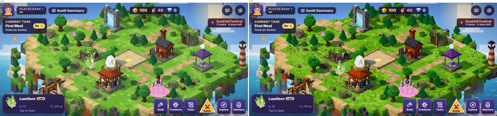
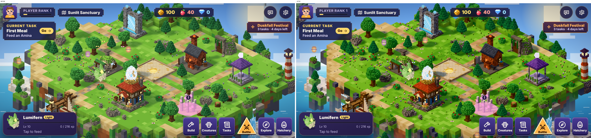
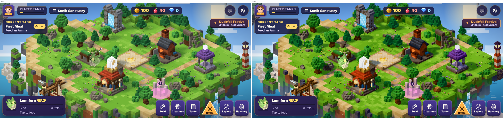
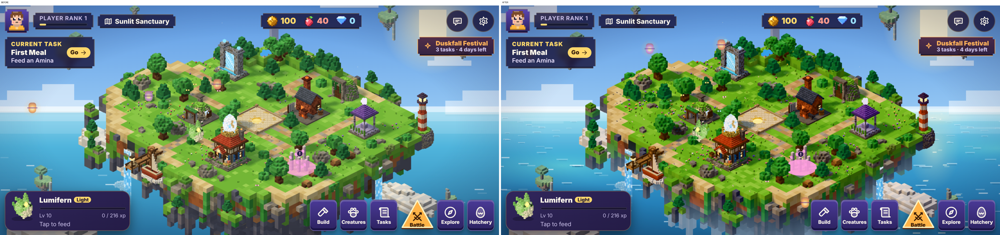
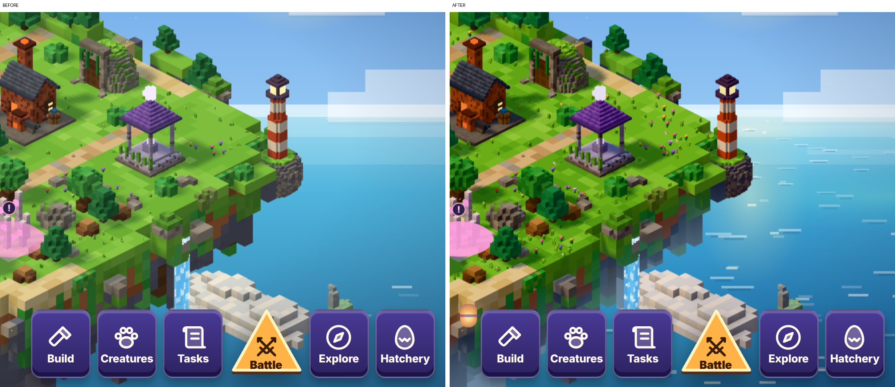
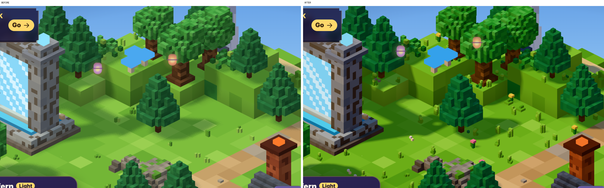
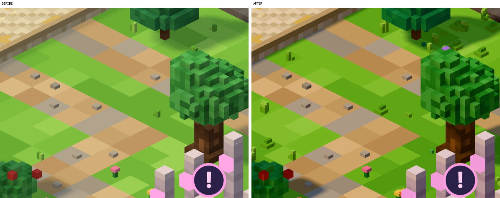
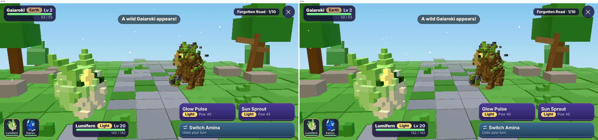

# Environment Phase 4: environmental visual refinement

- **Branch:** `env4-visual`, started from the head of `env3-mobile` (`01a08d7`). `main` and production are not
  touched.
- **Scope:** the four approved refinements:
  1. warmer lighting;
  2. softer shadows;
  3. richer water;
  4. denser vegetation.

  It adds no islands, monsters, buildings or gameplay. Layout, buildable cells, progression and saves are unchanged.
  No art was simplified; every building keeps full detail on High and Balanced.
- **Device testing:** **none yet for Phase 4.** Every frame rate and timing below comes from Chromium with software
  WebGL on a desktop CPU, emulating a phone at 844 × 390 @3×. That is good for comparing before and after, and says
  nothing about iPhone speed. The Phase 3 iPhone result (60 fps everywhere, about 2 ms of island CPU) is the reason
  this phase could spend more. **Please run Settings → Run performance test again on the iPhone.**

## 1. What changed

### Warmer lighting and colour grading (`voxstyle.js` `LIGHT`, `island3d.js`)

| | Phase 3 | Phase 4 |
|---|---|---|
| Sun | `#ffe6b8` at 2.2 | golden `#ffdeae` at 2.7 |
| Sky fill | `#eaf6ff` at 1.3 | cooler `#c6dcff` at 1.15: shade turns soft blue instead of grey |
| Ground bounce | `#b39a6c` | warmer `#d6a46a` |
| Grade | none | neutral tone mapping, exposure 1.04: bright tops roll off instead of clipping; hues hold |
| Aerial depth | none | the island's hanging rock fades towards the sky haze as it goes down (up to 50 % at 10 units), so the island reads as floating in bright air |

- The light was iterated three times against before/after crops:
  1. the first pass washed the meadow out;
  2. the second was too olive;
  3. the shipped values sit between them.
- Battles have their own renderer and moods and are **unchanged**. The before/after battle screenshots differ in
  0.28 % of pixels, all of it animation.

### Softer shadows (`perf.js` tiers, `island3d.js`)

| Tier | Shadow technique |
|---|---|
| High | variance shadow maps (2048, radius 3): wide, soft penumbrae. The map is blurred once when the shadow is redrawn, then one lookup per pixel. |
| Balanced | PCF (1024, radius 2) |
| Battery saver | PCF (512, radius 1) |

- Shadows are still redrawn only when the island changes, never per frame.
- With the cooler sky fill, shadows are coloured (blue-violet on paths and stone) rather than grey.

### Richer water

The Starter Island has no water cells. Its water is the sea far below the island and the two waterfalls, so that is
what changed:

- **Sea** (`island-art.js` backdrop, `style.css`):
  - a five-stop depth gradient, from horizon mint to deep sapphire;
  - shallow turquoise shelves;
  - faint cloud reflections;
  - a soft sun glow on the water under the sun, with its own glittering glints;
  - three rows of scattered voxel wave crests, each with a trough shadow, longer and thicker nearer the viewer. Each
    row drifts at its own speed and direction.
  - The motion is transform-only, so the compositor moves it without repainting. It pauses when the island rests, is
    covered or hidden, and holds still in Battery saver and with Reduce motion.
  - A first version used a regular pattern. It looked mechanical and was replaced.
- **Waterfalls** (`island3d.js` shader):
  - the body colour deepens towards the edges and with the drop;
  - pixel sparkles race down the sheet;
  - the streaks and churn are as before.
- The island water shader for future islands with lakes is not changed in this phase. No island currently has water
  cells to show it.

### Denser, handcrafted vegetation (`island3d.js` `buildDetail`, terrain)

- **Meadow detail:**
  - tufts are taller and more varied, with sunlit tips;
  - flowers grow in clusters of up to 4;
  - tall wildflowers stand in long grass;
  - clover drifts lie on lush ground;
  - daisies dot the open swards;
  - more pebbles lie on the beaches.
- **Under every tree:** a skirt of tufts, fallen leaves or needles, low fern sprays and pebbles, so groves sit in the
  ground instead of on it.
- **Broad meadow moods:** deeper green hollows and sun-warmed open swards, a slow noise layered over the fine colour
  mix.
- **Individual specimens:** every tree, bush and rock instance gets its own slight brightness and warmth. A grove of
  one species reads as individuals, not copies, at no draw-call cost.
- **Density by tier:**

  | Tier | Density | Detail pieces |
  |---|---|---|
  | High | 100 % | 3,328 |
  | Balanced | 85 % | 2,833 |
  | Battery saver | 55 % | 1,935 |

  The pieces lost their hidden bottom face, so each costs 10 triangles instead of 12.
- Trees and buildings themselves are **not remodelled**. Their models, silhouettes and LOD twins are exactly as in
  Phase 3.

## 2. Before and after

Phone emulation (844 × 390 @3×), Chromium, software GL. The left half is Phase 3 and the right half is Phase 4.
Ambient animation (creatures, sway, motes) means a few pixels always differ.

| View | File |
|---|---|
| Whole island, High |  |
| Whole island, Balanced |  |
| Whole island, Battery saver |  |
| Widest zoom (sea, underside, waterfalls) |  |
| Sea close-up |  |
| Grove, High (shadows, light) |  |
| Meadow, High (detail, shadow colour) |  |
| Battle (unchanged by design) |  |

## 3. Performance

### Method

`p4/probe.js` (saved in `perf/env4-*.json`) loads the same Starter Island in each tier and measures:

- triangles by layer;
- draw calls;
- resolution;
- shadow technique;
- the island's CPU time per drawn frame;
- build times;
- a 4 s camera pan.

The same machine, browser and settings were used for before and after. Software GL frame rates are 1–7 fps for
everything and are **not** phone frame rates.

### Results

| Tier (phone emulation) | Triangles before → after | Of which meadow detail | Draw calls | Shadows | Island CPU per frame (software) |
|---|---|---|---|---|---|
| High | 170k → **196k** | 7.6k → 33k | 68 → 68 | PCF 2048 → **VSM 2048** | 4.7 → 5.7 ms |
| Balanced | 170k → **191k** | 7.6k → 28k | 68 → 68 | PCF 1024 | 6.2 → 4.4 ms (noise) |
| Widest zoom (Balanced) | 127k → **147k** | 7.6k → 28k | 73 → 73 | PCF 1024 | 6.6 → 6.9 ms |
| Battery saver | 91k → **103k** | 7.6k → 19k | 69 → 69 | PCF 512 | 4.8 → 5.3 ms |

- **Draw calls are unchanged.** The extra detail lives in the existing single instanced mesh, and the tints use the
  existing instance batches.
- **Building triangles are unchanged:** 47,720 on High and Balanced.
- **Builds:**
  - terrain build: 250–400 ms in both phases;
  - object sync: 150–250 ms in both phases;
  - island first shown: about 5.5–6.4 s in both phases (software GL).

  The noise across runs is larger than any difference.
- **Per-frame GPU work added:**
  - one tone-mapping step and one haze mix per terrain pixel, both inside the existing shaders (no extra pass);
  - VSM's single lookup on High;
  - the sea's three transformed layers, composited behind the canvas.
- Against the budgets in `perf/PERFORMANCE_STANDARDS.md`:
  - High (196k) and Balanced (191k) sit just inside the A14–A15 column (200k);
  - Battery saver (103k) is inside the A12–A13 target (130k);
  - on an A12–A13 phone, Auto's step-down and the automatic Battery saver are the safety net.

**Untested:** none of this is measured on an iPhone yet.

### What to measure on the device

The phone test is unchanged and still covers every tier and zoom, plus the heat test. In particular:

- High's soft shadows at 1.5–2× the pixels of Balanced;
- whether the 3-minute run stays at 60 fps now that the island draws more.

## 4. Tests

`node tests/run-all.js`: **420 passed, 0 failed** across 14 suites. That is the 410 from Phase 3 plus the new
`browser-env4.test.js` (10 checks):

- the grade;
- soft shadows on High and PCF on Balanced and Battery saver;
- meadow density per tier, and restoring it when leaving Battery saver;
- individual tints;
- the sea's wave rows and sun path, held still in Battery saver;
- buildings at full detail;
- no script errors.

All earlier suites pass unchanged, including the battle and creature suites. Saves are untouched: no new fields.

## 5. Limitations and recommendations

- **No iPhone measurement of Phase 4 yet.** Please run the test, ideally with the heat test.
  - If High drops below 60 fps, the first lever is High's shadow technique (VSM → PCF). It is one line in the tier
    table.
  - The second lever is detail density.
- Tier switching recompiles the island's shaders once (shadow technique) and rebuilds the meadow detail. That is
  instant on a phone GPU but took a few seconds on software GL, which the tests allow for.
- The sea is still a painted backdrop with gentle parallax. It does not reflect the island itself. A true 3D sea
  plane was considered; in this orthographic view it would cover the sky without a horizon cut, so it was left for a
  later phase.
- The island lake/pond water shader (for future islands) was not changed. It should be upgraded together with the
  first island that has open water.
- The meadow detail is 1/16-cell blocks. At the widest zoom they are about 1–2 screen pixels and read as texture.
  That is intended.
- The lighting standard changed. The art bible §10 and the Godot workflow note are updated. Godot's light calibration
  should be redone when Godot scenes are built.

## 6. Next

When you approve, the natural follow-ups are:

1. device-tune from the new iPhone numbers;
2. apply the same light, detail and water language to the next island when its phase comes.

Phase 5 is not started.
