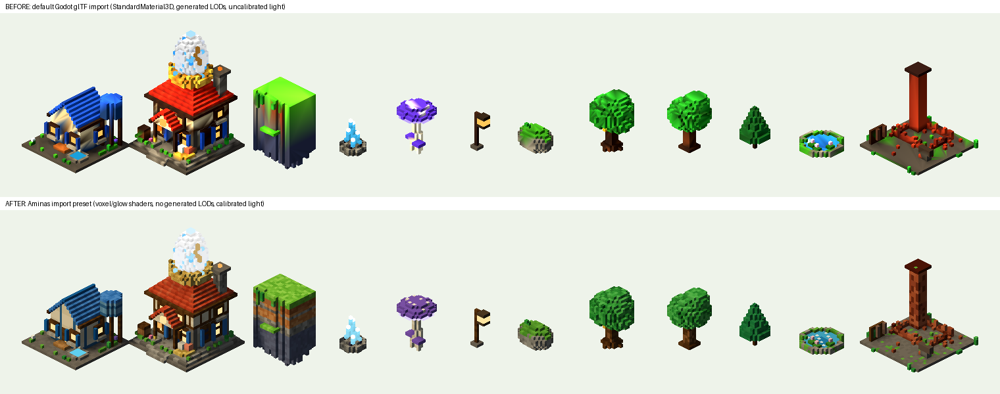
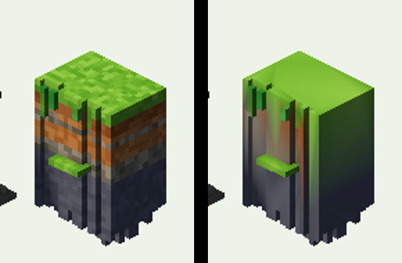

# Aminas → Godot 4: export and import workflow

*Environment Phase 3.* This was tested for real:

- **Godot 4.3-stable** (official Linux build), run headless on the build machine;
- rendered under a virtual display with the **Compatibility renderer**, through OpenGL 3.3 on Mesa llvmpipe, a software GPU;
- **12 library assets** imported, plus their 12 LOD twins.

Everything below was observed in that run. Some things were **not** tested:

- the Forward+ and Mobile renderers (Vulkan) were not available on the build machine;
- an iOS export was not built.

These are marked *untested* where they matter.

The validation project is in `godot/`. Run it again with:

```sh
node tools/export-library.js                       # writes assets/library/glb (+ _lod twins), vox, manifest
cp <the .glb files you want> godot/assets/         # LOD twins go in godot/assets/lod/
godot --headless --path godot --import             # imports with the Aminas preset (project.godot)
xvfb-run -a godot --path godot --rendering-driver opengl3 --script res://tools/validate.gd
```

It writes `validation_report.json` and two renders. Copies are in `docs/godot/`.

## 1. Result

| Asset | Category | Size (cells) | Vertices (full / LOD) | Scale | Pivot | Ground | Colours | Materials | LOD twin |
|---|---|---|---|---|---|---|---|---|---|
| b_habitat_2 | building | 3 × 2.25 × 3 | 14,984 / 3,140 | ok | ok | ok | ok | ok | ok |
| b_hatchery_1 | building (landmark) | 3.25 × 5.13 × 3.38 | 27,576 / 6,008 | ok | ok | ok | ok | ok | ok |
| r_forge | ruin | 3.5 × 2.88 × 3.5 | 9,496 / 2,224 | ok | ok | ok | ok | ok | ok |
| cliff_1 | terrain | 2 × 2.88 × 1.75 | 8,720 / 1,648 | ok | ok | ok (hangs below by design) | ok | ok | ok |
| mossyRock_1 | terrain | 1.5 × 1.25 × 1 | 1,784 / 464 | ok | ok | ok | ok | ok | ok |
| crystals_1 | terrain (glow) | 1 × 1.5 × 1 | 1,352 / 376 | ok | ok | ok | ok | ok | ok |
| oak_1 | vegetation | 1.63 × 2.38 × 1.63 | 3,576 / 960 | ok | ok | ok | ok | ok | ok |
| oakOld_2 | vegetation | 2.13 × 2.38 × 1.88 | 4,112 / 1,088 | ok | ok | ok | ok | ok | ok |
| pine_1 | vegetation | 1.13 × 1.88 × 1.13 | 1,624 / 392 | ok | ok | ok | ok | ok | ok |
| glowcap_2 | vegetation (glow) | 1.63 × 2 × 1.63 | 2,640 / 800 | ok | ok | ok | ok | ok | ok |
| lanternPost_1 | decoration (glow) | 0.75 × 1.63 × 0.38 | 584 / 120 | ok | ok | ok | ok | ok | ok |
| pond_1 | water | 1.75 × 0.5 × 1.75 | 2,064 / 448 | ok | ok | ok | ok | ok | ok |

- **Scale:**
  - 1 glTF unit is 1 island cell, and Godot keeps it. No root scale is needed.
  - Trees and canopies overhang their 1-cell footprint, as the art bible allows.
  - The Hatchery and Forge reach up to half a cell past their 3 × 3 footprint. The cause is front steps and the
    porch, which sit on the access cell. The first run flagged this; the rule now allows 0.55 cell for buildings.
- **Pivot:**
  - The origin is the centre of the footprint, at ground level (y = 0).
  - The largest offset is the lantern post's arm, at 0.25 cell.
- **Geometry:**
  - Every face is its own quad, with flat normals and colours per vertex. No vertices are shared, so vertex counts
    are about 4 × the triangle count ÷ 2.
  - This is correct for voxel art.

**Instancing.** 400 trees as `MultiMeshInstance3D` rendered correctly:

- 4 nodes in total: oak and pine, each full and LOD;
- full and LOD were switched with `visibility_range` (`docs/godot/godot-multimesh-grove.png`).

## 2. Three compatibility problems found and fixed



### Problem 1: colours dark and over-saturated in the Compatibility renderer

- **Cause:**
  - glTF stores `COLOR_0` in linear space, and Godot imports it unchanged. That was checked by reading back the
    vertex data: the glb holds `0.251, 0.609, 0.078` and Godot holds `0.247, 0.608, 0.075`.
  - The Compatibility renderer shades in sRGB space (`OUTPUT_IS_SRGB`).
  - `StandardMaterial3D` with `vertex_color_is_srgb = false` therefore uses linear values as if they were sRGB.
  - Toggling `vertex_color_is_srgb` made no difference in this renderer. This was tested.
- **Fix:** two small shaders, `godot/pipeline/aminas_voxel.gdshader` (lit, Lambert, rough, no specular) and
  `aminas_glow.gdshader` (unlit). Each encodes the vertex colour to sRGB when `OUTPUT_IS_SRGB` is true. In the linear
  renderers they leave it alone, so one material is correct everywhere. This is *untested on Vulkan* and follows
  Godot's documented `OUTPUT_IS_SRGB` behaviour.

### Problem 2: Godot's automatic LODs smear voxel colours

- **Cause:** the default import generates LODs by mesh decimation. On flat-shaded voxel meshes, the decimation merges
  faces of different colours. Cliffs turned into gradients at moderate distance.

  

- **Fix:** turn off `meshes/generate_lods` and use the exported `_lod.glb` twins. These are voxel-correct half
  resolution, about 20–30 % of the vertices. Switch with `visibility_range_begin` / `visibility_range_end`
  (see §4).

### Problem 3: the game's light values blow out in Godot

- **Cause:** three.js and Godot scale light differently. With the raw values from `LIGHT` (sun 2.2, hemisphere 1.3),
  the greens clip at 255.
- **Fix:** calibration, done by sampling the same faces in the web viewer and in Godot:
  - **Compatibility renderer:** sun 0.4, ambient colour `#eaf6ff` at 0.12;
  - **Forward+ / Mobile (linear):** start from sun 2.2 / π = 0.70 and ambient 1.3 / π = 0.41, then check against the
    web viewer (*untested*).
- **Result:** after calibration, the grass top in Godot is RGB 113, 169, 47; in the web viewer it is 113–131,
  180–191, 54–66.
- **Light settings for both renderers:**
  - sun colour `#ffe6b8`, direction from (−9, 22, 17);
  - background `#bfe0f6` (`haze`);
  - tonemap Linear.

## 3. The import preset

Set it once per project. `godot/project.godot` has it under `[importer_defaults]`, so every new `.glb` imports this
way:

| Setting | Value | Why |
|---|---|---|
| `import_script/path` | `res://pipeline/aminas_import.gd` | swaps in the Aminas shaders, turns shadow casting off for glow surfaces, names the root after the file |
| `meshes/generate_lods` | `false` | problem 2 |
| `meshes/ensure_tangents` | `false` | no textures, so no tangents (smaller meshes) |
| `meshes/create_shadow_meshes` | `true` | Godot's default; keeps shadow passes cheap |
| `meshes/light_baking` | static (1) | Godot's default |
| `nodes/root_scale` | `1.0` | 1 unit = 1 cell already |

Copy `godot/pipeline/` (two shaders and the import script) into any Godot project that will use Aminas assets.

## 4. Rules for assets going to Godot

1. **Export** with `node tools/export-library.js`. Do not hand-export from three.js; the exporter writes the
   materials (`aminas_voxel`, `aminas_glow` with `KHR_materials_unlit`) that the import script recognises.
2. **Every variant ships with a twin:** `<id>_<variant>.glb` and `<id>_<variant>_lod.glb`.
3. **Pivot:** the centre of the footprint, at the ground. Rotate in 90° steps only. The art is designed for the four
   isometric facings.
4. **Placement:** 1 cell = 1 unit. Snap buildings to whole cells. Natural props may sit on half-cell offsets.
5. **Repeated scenery** (trees, rocks, grass, crystals) goes in `MultiMeshInstance3D`, one per mesh surface. Glow
   surfaces are a separate surface, so a glowing tree is two MultiMeshes.
6. **LOD switching:** full model with `visibility_range_end = D`, twin with `visibility_range_begin = D`. A starting
   point for D is the distance at which a prop voxel (1/8 cell) covers about 2 screen pixels. This is the same rule as
   the web game's widest-zoom switch. Buildings keep full detail longer than nature.
7. **Glow** is unlit and casts no shadow. If the Godot game adds bloom (`Environment.glow_enabled`), glow surfaces are
   the only ones bright enough to trigger it. That matches the web game's look; there is no bloom in the web game
   today.
8. **Renderer:** for iPhone, use the **Mobile** renderer (Metal through MoltenVK in Godot 4.3). Use Compatibility for
   the web and very old devices. The shaders cover both. *An iOS export was not built or tested in this phase.*
9. **MagicaVoxel (.vox):**
   - use it for hand edits only;
   - the round trip back into the library is manual;
   - opening the files in MagicaVoxel was **not** tested (it was not available).

## 5. How the light was calibrated

`godot/tools/validate.gd` accepts `SUN_E`, `AMB_E` and `LOD_THRESHOLD` environment variables. The same faces were
sampled in the web viewer render and in the Godot render: the cliff grass top and the oak canopy. A 3 × 3 sweep over
the sun and ambient energies picked the closest pair. Repeat the sweep for any other renderer before trusting its
colours.
