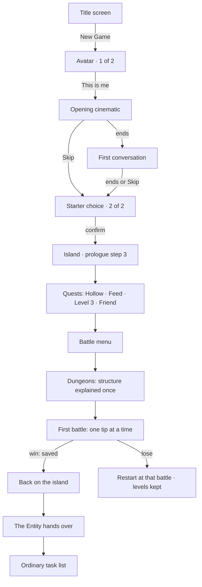
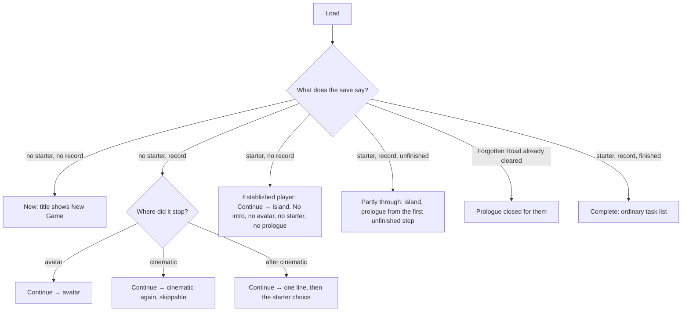

# Phase 16A — Story, onboarding and the first-time player experience

Branch `p16a-onboarding`, made from the Phase 15D branch `p15d-final-polish` at `b37dac1` (verified: local and remote
heads matched, the working tree was clean, `main` is at `0fc9e36` and is untouched). Nothing is merged.

Everything new runs only while the **Phase 16A switch** is on. It is a separate developer switch from the Phase 15 one
(which is still off by default and was not changed). Turn it on from the chip at the bottom left of the title screen,
or with `?p16=1` or `#p16` in the address. It is remembered in that browser only, never in the save. With the switch
off, the game is the Phase 15D game: the original intro cards, dialogue panel, starter sheet and HUD.

## 1. Audit: what existed before

| System | Where | Finding |
|---|---|---|
| Opening | `ui.js` `playIntro` + `story.js` `T.introCards` | Six text cards of lore on a plain orb, then the arrival script. They explained the Light and Dark war and the Resonance outright. |
| Arrival | `story.js` `T.scripts.arrival` | Ten lines, a lot of exposition in one go: "The island was wrecked in the World Resonance. Islands in the wrong places…" |
| Dialogue panel | `ui-v07.js` `UI.script` | A solid base: voxel Entity with moods, typing, Auto, Skip, Reduce Motion. No speed control in the panel, no pacing at punctuation, no keyboard, no player lines. |
| Story scenes | `ui-scene.js` + `scenes.js` | A separate scene player for dungeon story beats (left as it is). |
| Avatar | `ui-dev8.js` `UI.avatarCreator` | A complete creator (6 parts, name, Surprise me, editable later from Profile). Kept; only framed. |
| Starter choice | `ui.js` `UI.starterSelect` | A small sheet with two portraits, element chips and personality. No combat facts, no history hint, no confirmation step. |
| Objectives | `quests.js` + the HUD task pill | A full quest engine with navigation (`Nav.resolve`, `UI.go`) and highlights. Reused, not duplicated. |
| Combat help | `ui2.js` | The battle screen already shows the turn indicator, "▲ Strong / ▼ Weak", recharge counters, status chips and boss telegraphs. There was no step-by-step introduction. |
| Saves | `state.js` | Schema 6, migrations 1→6, loader keeps unknown fields. `hasSave()` needs a chosen starter, so a game stopped before the starter could not be continued. |

**An important finding about the first battle.** The first dungeon (the Forgotten Road) opens as soon as the Sunlit
Hollow is restored, but its first battle is against a level 2 Gaiaroki. I simulated it with the real rules (200
seeded battles each, best available move every turn):

| Party | Lumifern wins | Umbrit wins |
|---|---|---|
| Starter alone, level 1 | 0 / 200 | 0 / 200 |
| Starter alone, level 3 | 185 / 200 | 4 / 200 |
| Starter alone, level 5 | 200 / 200 | 186 / 200 |
| Starter level 3 + Acinus level 2 | 200 / 200 | 200 / 200 |

So a new player who walked straight into the dungeon would lose. The existing quest chain already prepares for it
(Growing Pains: level 3; A Friend of the Meadow: a second Amina; the dungeon's recommended level is 4). The guided
prologue follows that order rather than changing any numbers, so no one is asked to lose on purpose.

## 2. The first-time player journey

| # | Step | How it completes | Reward |
|---|---|---|---|
| — | New Game → **avatar** ("1 of 2") | Confirming the avatar | none |
| — | **Opening cinematic** (about 10 s, skippable) | Seen or skipped | none |
| 1 | **Meet the Entity** (first conversation) | Automatically | none |
| 2 | **Choose your Amina** ("2 of 2") | Confirming a starter | the starter, as before |
| 3 | Look at your companion | Opening its details page (soft step) | none |
| 4 | Make Room for Kind Souls | Existing quest: restore the Sunlit Hollow | the quest's own |
| 5 | First Meal | Existing quest: feed | the quest's own |
| 6 | Growing Pains | Existing quest: level 3 | the quest's own |
| 7 | A Friend of the Meadow | Existing quest: a second Amina (Explore) | the quest's own |
| 8 | Open the Battle menu | Opening it (soft step) | none |
| 9 | Enter the Forgotten Road | Starting a run there | none |
| 10 | Win your first battle | Any win | the battle's own |
| 11 | Return to the sanctuary | Being on the island after the win (soft step) | none |
| 12 | Hear what comes next | The Entity's handoff | none |

The other buildings come in their own time, not as tutorial stops. The first time the Hatchery or the Forge is opened,
the Entity adds one line. Restoring the Hollow plays its existing "first restore" scene.

**Rules for the steps:**

- Every step is worked out from the save each time it is read, so it always matches what the player has done.
- Doing things in another order never blocks anything. A soft step (look, open the menu, return) counts as passed as
  soon as any later step is done.
- The four quest steps are the existing quests, with their own Go navigation and their own rewards, claimed exactly as
  before. The other steps give nothing.
- The prologue closes by itself after the handoff, or at once for anyone who has already cleared the Forgotten Road.

## 3. New-player and returning-player flows

## 4. The opening cinematic

Shots, using the game's own art:

1. **The Resonance:** two thin rings of colour open out of the dark.
2. **Fragments:** pieces of four other places drift in, under the captions "Some places were never meant to meet." and
   "They met anyway." The pieces are the real dungeon backdrops: the Heartwood, the Gathering Hall, the Road's End,
   and the mural of the two small figures.
3. **The crack:** the fragments fall away in a soft flash.
4. **The island:** the real Sunlit Sanctuary view fades in with a slow push.
5. **The arrival:** a column of light, a ring in the grass and the player's own avatar in it. The ring is the existing
   "arrival mark" lore.
6. **The Entity notices,** startled, then the first conversation begins.

**Player control:**

- **Skip** is always on screen (44 pt) and goes straight to the starter choice.
- The timeline pauses while the app is hidden and resumes when it returns. It does not depend on audio, so an audio
  interruption cannot stall it.
- If the app is closed mid-cinematic, Continue replays it (still skippable).
- **Reduce Motion:** cross-fades only. The rings, fragments, light column and camera push do not move.
- **Battery Saver:** two fragments instead of four, one ring, no drop-shadow glow and no camera push.

## 5. Dialogue

With the switch on, every Entity conversation in the game uses the refined panel:

- the amethyst-glass sheet with a crystal rim and a gold name plate;
- progress pips;
- the Entity's portrait reacting when its mood changes;
- the player's own lines, with their avatar and name;
- typing that holds briefly at full stops, ellipses and dashes, so a hesitation reads as one;
- soft, rate-limited type ticks (only with sound effects on);
- **Speed** (the existing slow / normal / fast setting, cycled from the panel and saved), Auto and Skip;
- tap, Space, Enter or → to advance; Escape closes.

Reduce Motion shows each line at once. The complete opening transcript is in `docs/PHASE16A-transcript.md`.

**Lore choices (all within the brief):**

- **The Resonance** is named once, by the Entity interrupting itself ("Since the Resonance— since things changed"),
  and never explained.
- **The island's origin** is hinted, not stated: "It came a very long way to be here."
- **The unnamed force:** the player's arrival is unusual from the first line ("…You again. No. That isn't quite
  right."). One slip comes at the starter choice ("They don't usually agree on anything") and one at the handoff
  ("You held that line like someone who had done it before. Have you?"). The existing rank-up slips continue after
  that, so the hints grow with progress. Nothing names or defines the force.
- **The starters' history:** "They were inseparable once, those two lines. Once." A faint mural motif of two small
  figures sits between them on the selection screen, echoing the Forgotten Road mural. Nothing explains the quarrel.

## 6. Character creation

The existing creator is kept as it is (the same options, the same saving). With the switch on:

- it says "1 of 2";
- the Entity has one dry line in the header;
- the note at the bottom says exactly what can be changed later and where ("your name, look and outfit … from your
  profile (your head, top left). Nothing else depends on them").

The whole step fits the 844×390 screen. No new options were added. Comparison screenshots: `docs/ui/screens16a/`.

## 7. Starter choice

Both starters share one stage, split warm gold and violet, with the mural motif between them. Each card shows:

- the portrait of its real 3D model;
- its name and element chip;
- its personality line from the roster;
- "In battle": which real level-1 stats are higher than the other starter's (Lumifern: more health and defence;
  Umbrit: more attack and speed);
- strong against and weak to, from the element chart;
- its real moves, with special and heal marks.

Tapping a card brings that starter alive in the 3D viewer (it stays a portrait in 2D mode). The other card dims and
turns away, and the Entity says one line about the chosen one. Choose opens a confirmation naming the starter, with
Back. Yes grants exactly one starter at level 1 through the same rules as before. The node test compares the result
with the original code path. A second tap or a stale button does nothing.

## 8. First battle and first dungeon

**The battle coach.** In the prologue's dungeon battles, one short callout at a time points at the part of the screen
it is about:

- your move;
- health bars;
- the turn indicator (whose turn, who acts first);
- ▲ Strong and ▼ Weak, with the actual elements named;
- special-move recharge;
- status chips;
- on battle 10, the guardian's warnings.

Each callout is shown once. It never covers a move button (tested), goes away when you act, and has a ✓ to dismiss
it. It reads the battle; it changes nothing. A seeded battle ends with identical health, result and turn count with
the switch on and off. It also works on the 2D stage.

**Winning and losing:**

- The first victory card adds "Saved. A battle you win stays won."
- The first section reward adds "First time through a section pays extra. Replays don't."
- The existing defeat card already explains losing ("Progress kept: next time you start at battle N", levels kept),
  so nothing was added there.

**The dungeon introduction.** The first visit to Dungeons explains the structure:

- ten dungeons, ten battles each;
- the tenth is the guardian;
- the last guardian lets you go further;
- a loss restarts at that battle;
- the Forgotten Road's own recommended level.

It plays once. The dungeon system itself is unchanged.

## 9. Save compatibility

- **No schema change and no migration.** A new game started with the switch on gains one optional field, `onboard`:
  where it is, the cinematic state, which tips were seen, and whether the prologue is done. Nothing else in the save
  changes.
- **Existing saves never gain the field** and are treated as established players. Tested: load, play and save keep it
  out.
- A damaged `onboard` value is ignored safely.
- **Games stopped before the starter can now be continued** from the title screen. The resume points are the avatar,
  the cinematic, or the starter choice.
- **Existing monsters, currencies, buildings, progress and equipment are untouched.** Opening the Hatchery and the
  Forge with the switch on changes nothing except the one-time tip flag (tested).

## 10. Mobile rendering costs (desktop software rendering, not iPhone)

From `docs/ui/screens16a/o16-measure.json` (desktop Chromium, SwiftShader software WebGL, 844×390). These figures say
how heavy the new pieces are relative to each other; they are not iPhone performance.

| Piece | Normal | Battery Saver | Reduce Motion |
|---|---|---|---|
| Cinematic length | 10.9 s | 10.9 s | 10.4 s |
| Elements in the cinematic overlay (peak) | 712 | 180 | 712 |
| CSS animations running at once (peak) | 27 | 12 | 0 |
| Frame pacing during the cinematic (median / 95th percentile) | 16.7 / 16.8 ms | 16.7 / 16.8 ms | 16.7 / 16.7 ms |

- Most of the overlay's elements are the four fragment backdrops: they are the dungeons' existing SVG scenes. Battery
  Saver draws two.
- Only `transform` and `opacity` are animated. The real island behind the cinematic is the existing island view, at
  its existing cost.
- **Starter screen:** 552 elements. One live 3D viewer at a time, and switching starters never leaves a second viewer
  running (checked). The Lumifern viewer drew 5 calls and 986 triangles.
- **Battle coach:** checks the battle four times a second while a prologue dungeon battle is open. Each check took
  0.025 ms, about 0.08 % of one 30 fps frame. It stops when the battle closes.
- **Dialogue panel:** the existing panel's cost plus a few elements (name plate, progress pips, the player's head).

## 11. Tests

**New suites:**

- `tests/onboard16.test.js` (Node, 37 checks): classification, resume points, one-time starter grant compared with
  the original code path, real starter facts, state-derived steps in and out of order, soft steps, returning players,
  save compatibility and no reward or battle change (seeded event log).
- `tests/browser-onboard16.test.js` (Chromium, 69 checks): the opening with the switch off (unchanged) and on;
  avatar layout; the cinematic (pause while hidden, audio interruption, Skip); the dialogue (speed, keys, names);
  the starter screen (real data, layout, confirmation, repeated taps); prologue steps; interrupted, established,
  partly played and finished saves; the coach (one tip at a time, never covering a move, identical outcomes with the
  switch on and off, 2D fallback); the dungeon introduction; the first victory note; the handoff; Reduce Motion;
  Battery Saver; the Hatchery and Forge unchanged.

### The memory-release check (browser-arena7): the approved timing fix did not work, so it is not applied

As approved, I made the check wait for an actually rendered frame before leaving each battle, with the threshold and
the clean-up measurement unchanged. It made things worse, not better, so I reverted the test to the Phase 15D
version. The evidence is in `docs/ui/screens16a/`.

**With the frame wait:**

| Run | Result | GPU geometries per round |
|---|---|---|
| Phase 16A code, run 1 | failed | 14, 17, 17 |
| Phase 16A code, run 2 | failed | 14, 17, 17 |
| Phase 15D code (`b37dac1`) | failed | 14, 17, 17 |
| Probe tool, in place in `tests/` | failed | 14, 17, 17 |
| Probe tool, from `tools/` | passed | 23, 23, 23 |

**Without it:**

| Run | Result | GPU geometries per round |
|---|---|---|
| Phase 16A code, original test | passed | 17, 17, 17 |
| Probe tool, from `tools/` | passed | 20, 20, 20 |

**What the per-battle probe shows** (`tools/arena7-probe16.js`; the failing per-battle run is
`arena7-probe16-wait-failing-run.log`, two passing runs are `arena7-probe16-wait.log` and `arena7-probe16-nowait.log`):

- Every battle's arena, effects and highlights are freed when it is left. Geometry falls back to the cached-template
  level every time, and textures return to 3.
- The 14 → 17 step is a fifth creature template being cached at the start of round 2's first battle (templates 4 → 5,
  3 geometries each). Nothing is retained from a battle.
- How many templates a run caches varies (4 to 7 here). The check fails whenever one of them is first cached in round
  2 instead of round 1. That depends on timing, and the frame wait shifts that timing.
- So the cause is when the deliberate template cache fills, not a frame that has not been drawn. Waiting for a frame
  cannot remove it.

**A fix that would work** (needs your approval because it changes what the check compares; the threshold would stay):
run one unmeasured warm-up round first, so the template cache is full before the first measurement.

### Full regression

See section 12, filled in after the complete run.

## 12. Regression results

(pending)

## 13. Known limitations

- **Behind a developer switch.** Players with the switch off (the default) see the Phase 15D opening. Turning it on
  for everyone is a decision for you.
- **Not tested on an iPhone.** Every measurement and recording is desktop Chromium with software WebGL at 844×390.
  Touch targets, safe areas and frame pacing need a real device.
- **Speed setting.** The dialogue Speed control is the existing three-step setting. There is no "instant" option; the
  existing Reduce Motion setting shows lines at once.
- **The handoff points to the road, while the task pill shows the existing chain's next task.** The existing chain's
  next task is usually "Clear the Way", not the Forgotten Road. I did not reorder the quests.
- **The first-battle coach** runs only in the prologue's dungeon battles. Practice, PvP, Survival and Hide and Seek are
  untouched.
- **Old saves stopped before choosing a starter** (made before Phase 16A) have no record and still start over from
  New Game, as before.
- **The memory-release check** remains intermittent (see section 11).
- **The five simulated slow-device failures** in `browser-perf-fix` are carried forward. See the regression results.

## 14. Recommendations for Phase 16B

1. Play the opening on a real iPhone (Safari and Home Screen) and confirm cinematic smoothness, touch comfort,
   audio after interruptions, and the dialogue panel with large text settings.
2. Decide whether the Phase 16A opening becomes the default for new games, and whether the old intro cards are kept
   anywhere (for example in the Journal).
3. Approve or decline the arena7 warm-up round (section 11).
4. Consider a short in-world marker for the Forgotten Road once the prologue hands over, and whether "Clear the Way"
   should come after the road in the quest order (a progression change, so for your decision).
5. Voice: a few one-time Entity lines for the Hatchery's first egg and the first evolution, in the same restrained
   tone.
6. Accessibility: a larger-text option for the dialogue panel, and an "instant text" speed.
