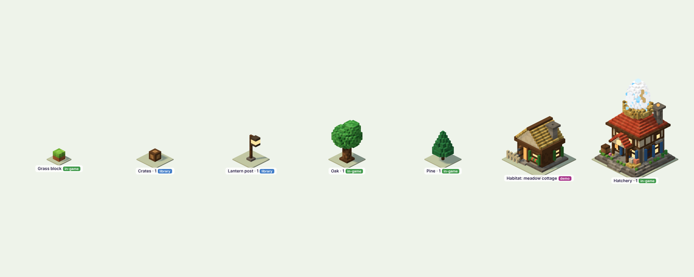
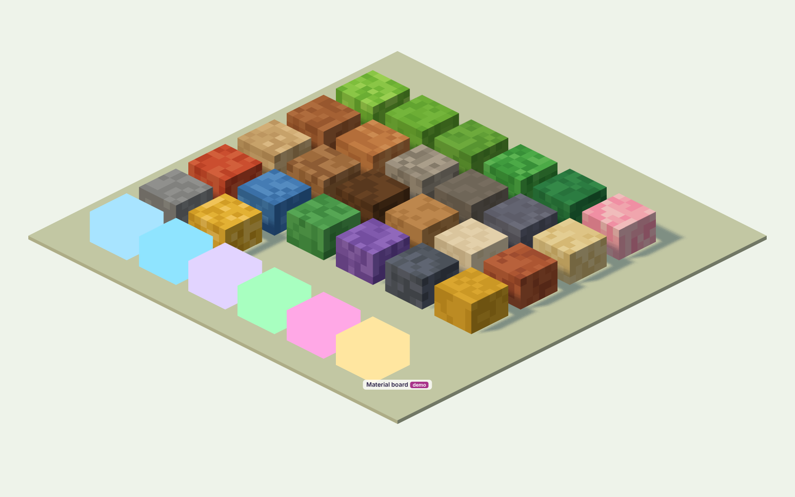
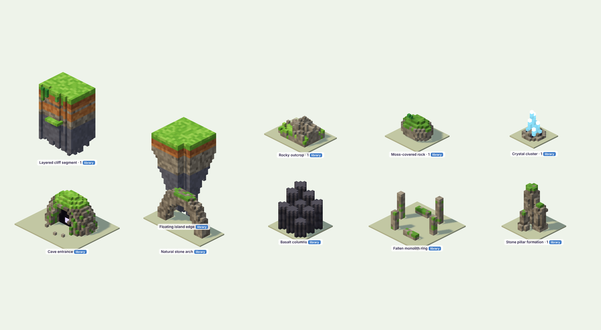
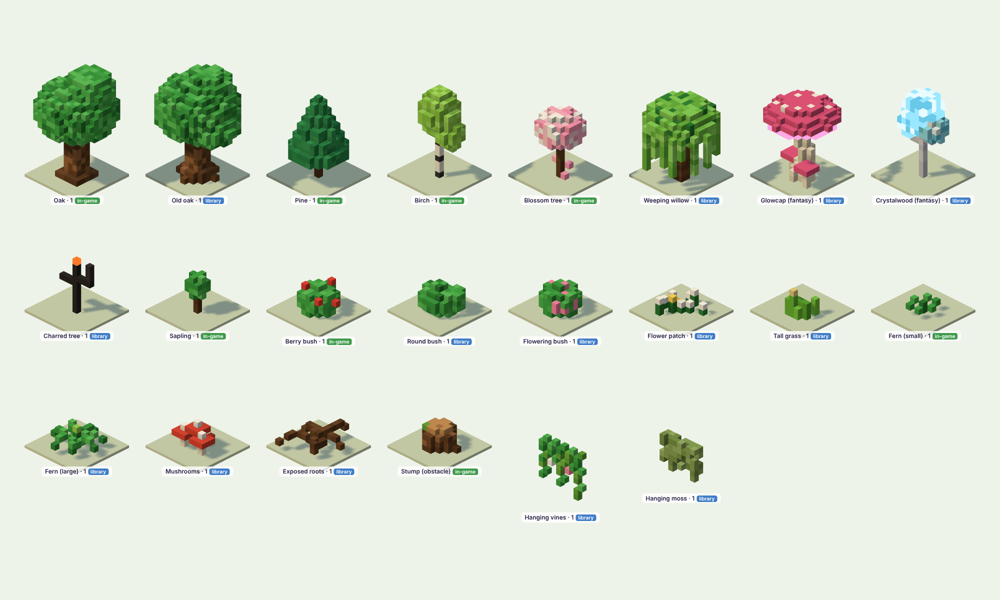

# Aminas — Environment Art Bible

*Environment Phase 2. The permanent visual standard for every island, building and prop in Aminas.*

Related documents:

- `02_ASSET_LIBRARY.md`: the library.
- `03_ARCHITECTURE_STANDARDS.md`: buildings.
- `04_ISLAND_IDENTITIES.md`: future islands.
- `../ASSET_REGISTER.md`: sources and licences.

All plates are real renders from the library viewer (`tools/library.html`) or the running game, under the game's own
camera and lighting. None is concept art.

---

## 1. Direction: colourful voxel fantasy

Aminas is **a classic pixel-art fantasy world built in three dimensions.** It has five pillars:

1. **Every surface is made of visible blocks.** No smooth meshes, no painted textures, no photo materials. Detail
   comes from more, smaller blocks and from colour, not from texture.
2. **Rich, warm colour.** Saturated greens, warm earths, clear sky blues and jewel-toned magic. The world should look
   sunlit and inviting at any zoom.
3. **Handcrafted, never generic.**
   - Every building has its own silhouette.
   - Every tree species has at least three shapes.
   - Every prop tells you something about who lives there.

   If an asset could appear unchanged in any block game, it is not finished.
4. **Layered geology.** Islands are floating chunks of real-looking earth, with:
   - grass that drapes over the rim;
   - bands of earth, clay and stone;
   - a rock root tapering below;
   - water that falls off the edges.
5. **Detail with breathing room.** Dense where it matters (around buildings, along paths, on hills), open where the
   player plays and builds. Detail never hides interaction.

**What Aminas is not:** generic Minecraft-style cubes at one scale, smooth low-poly mobile art, or realistic PBR.

## 2. Geometry and scale

The camera is the island's fixed isometric view: an orthographic projection matched exactly to the 2D grid.
**1 world unit = 1 island cell.** Height: 1 unit = 39.2 screen px at zoom 1.

| Voxel | Size | Used for |
|---|---|---|
| **Terrain voxel** | 1/2 cell (2×2 per cell) | island ground, cliffs, strata, the hanging root, cloud banks |
| **Prop voxel** | 1/8 cell (8×8 per cell) | buildings, trees, rocks, props, everything in the library |
| **Detail voxel** | 1/16 cell | grass blades, flowers, pebbles, shells (instanced) |

**Rules**

- Never mix voxel sizes inside one surface.
- A model's footprint is its gameplay footprint: a 3×3 building is 24×24 prop voxels. Overhang is at most 1 prop
  voxel (eaves, sills).
- **Height budget** (in cells):

| Object | Height |
|---|---|
| Ground props | under 0.5 |
| Shrubs | 0.5 |
| Small trees | 1.5 |
| Tall trees | 2–2.5 |
| Houses | 2–3 |
| Landmarks (Hatchery egg, towers, the lighthouse) | up to 4 |

- Tall elements go to the back of a footprint, so they never hide its front.
- **Silhouette test:** at the default zoom, every building must be recognisable from its outline alone.



## 3. Construction method

- **Built in code, from colour codes.** Each asset is a builder function that fills a voxel grid (`Model` in
  `src/3d/voxbuild.js`). The grid is meshed so that only faces touching air are emitted, with per-vertex corner
  darkening (AO: 60 / 75 / 88 / 100 %) and baked face shading:

| Face | Shading |
|---|---|
| Top | 100 % |
| Left / front | 93 % |
| Right | 86 % |
| Underside | 60 % |

- **Three kinds of block**, each meshed into one geometry per asset:

| Kind | Material | Use |
|---|---|---|
| **Solid** | lit (Lambert), casts and receives shadow | almost everything |
| **Glow** | unlit, full colour, no shading | windows, flames, crystals' tips, runes, the egg's speckles |
| **Self-lit** (`'u'`) | unlit but keeps face shading and AO | things that must keep their colour in any light, such as the white egg and crystal bodies; use sparingly |

- **Composition:**
  - `at(m, dx, dy, dz)` places any part or asset inside another, so scenes and buildings are assembled from library
    pieces.
  - `kit.js` holds the architectural parts.
  - `MAT` holds the materials.
- **Variants:** every natural asset ships with at least three seeded variants (shape, not just colour). The island
  also varies scale (±15–35 %) and rotation (four quarter turns) per instance.

## 4. Colour

Every surface picks from a **short palette of 2–5 close shades** using a position hash. The result is lively but
never noisy. Large single-colour areas are not allowed. Palettes live in `src/3d/voxstyle.js` (`PAL`, `EL`, `MAGIC`).

| Group | Palette (hex) | Notes |
|---|---|---|
| **Meadow grass** | `#86d24a #7bc943 #93db55 #72c03f #a4e562` | warm yellow-green; tops of all grass |
| Grass side / drape | `#74c041 #69b53c #7cc848` | the lip that hangs over cliffs |
| **Leaves** | `#45ad4c #52bc57 #3c9f45 #62c764`, dark `#358c3e #2f8038` | *bluer* than grass, so trees separate from the meadow |
| Pine | `#2f8a50 #2a7f49 #389858` | the darkest green: depth in groves |
| Moss | `#68b043 #74bc4a #5ea53d` | on stone tops, cliff faces, ruins |
| **Dirt** | `#b06c40 #a26139 #bb784b` | under grass, 2–3 voxels |
| **Clay** | `#cf8a52 #c07a47 #d99a62` | the warm orange band in every cliff |
| **Stone** | `#a8a29a #99938b #b5afa6 #8d877f`, dark `#77716b #7f7973` | coursed masonry and cliff rock |
| Deep rock | `#7d7b8c #757385 #868496`; low `#6a6f88 #63687f #727892` | cooler and bluer as it goes down (atmospheric depth) |
| Sand / path | sand `#ecd9a0 …`, path `#e0c08e #d4b380 #e8cc9c #c9a674` | warm and light: paths read from far away |
| **Wood** | `#a8774a #966640 #b8875a`, dark `#6e4a2c #5e3f26`, plank `#c9965e #b9864f` | dark wood frames, light planks |
| Plaster / brick | plaster `#f2e6cc #e8dabc`, brick `#b8603e #a8553a #c46c48` | |
| **Roofs** | red, blue, green, purple, slate, gold (3 shades each) | shingle rows alternate shade; eaves dark |
| **Magic** (`MAGIC`) | egg `#a8e4ff`, water `#8fe4ff`, moon `#e2d4ff`, life `#a8ffc0`, spirit `#ffa8e6` | enchantment only |
| **Hearth light** | glow `#ffe6a0`, warm `#ffb860`, cool `#9ae8ff` | windows, torches, lanterns; never used for magic |

**Value structure**

- Top surfaces are mid-to-light and saturated.
- Shade and dark accents go to timber frames, window frames, eaves, undersides and the deep root.
- Never darken a whole object to make it "moody". Use light and atmosphere instead.

**Separation rule:** the four big masses must each be distinguishable at a glance by hue *and* value:

- grass (yellow-green);
- trees (blue-green);
- stone and buildings (warm grey or plaster, with coloured roofs);
- paths (light warm).



## 5. Terrain and ground materials

Every ground column follows the **layer rule**, used by the island generator and every terrain asset:

```
grass cap (1)  →  grass lip / drape (1–3, only on rims)  →  dirt (2–3)  →  clay band  →
alternating clay / stone strata  →  coursed stone  →  cool deep rock  →  a jagged, tapering root with spires
```

- **Rims:**
  - grass always drapes over a rim, never a hard edge;
  - vines and moss hang in places;
  - small rock formations bulge out of the face.
- **The underside** tapers into a rock root, deeper towards the middle, so every island reads as floating.
- **Paths and plazas** sit flush with the grass and are edged with stone where they meet it.
- **Water** is a separate animated surface over a visible bed. Rims never end in a straight vertical drop of one
  colour.



## 6. Stone, rock and geology

- **Formations:**
  - pillars in clusters of 2–3 heights;
  - outcrops that push up through the grass;
  - moss-capped boulders;
  - natural arches;
  - basalt columns;
  - fallen monolith rings;
  - cave mouths with a faint inner light.
- **Crystals** are magic made solid. They use only `MAGIC` hues, with self-lit faceted bodies and glowing tips, on a
  dark rock base.
- **Weathering:**
  - every exposed stone top above head height gets moss in patches (never all over);
  - cliffs get vines;
  - old stone gets dark joints.

## 7. Wood and architectural materials

`MAT` in `src/3d/library/kit.js` defines each material once:

| Group | Materials |
|---|---|
| Masonry | `ashlar` (dressed pale stone), `stone` (coursed grey), `rubble` (field stone), `brick`, `slateStone` (dusk / moon buildings) |
| Timber | `plank`, `plankLight`, `log`, `beam` (dark frame), `plaster` |
| Roofing | `roof(colour)` shingles, `thatch`, `turf` |
| Metal | `iron`, `gold`, `trimDark` |

**Material meeting rules**

- Wood never touches the ground: there is always a stone footing course.
- Timber framing outlines every plaster panel.
- Every roof has a dark eave course and, on gables, a dark ridge cap.
- Masonry corners get darker quoins.

## 8. Vegetation

- **Construction:**
  - trunks are dark wood;
  - canopies are built from several overlapping lobes, never one sphere;
  - leaves are bluer than the grass;
  - every species has one accent (fruit, blossom, glow, moss, seed heads).
- **Collection:**

| Group | Species |
|---|---|
| Trees | oak, old oak, pine, birch, blossom, willow, sapling |
| Fantasy trees | glowcap (mushroom tree), crystalwood, charred tree |
| Shrubs | berry, round and flowering bushes |
| Ground | flower patches, tall grass, small and large ferns, mushrooms, roots |
| Hanging | vines, hanging moss |

  See `02_ASSET_LIBRARY.md` for the full list.
- **Placement: groves, not scatter.**
  - A slow noise field chooses the grove type (pine stand, oak wood, birch-and-blossom copse).
  - Open glades hold tall grass, ferns, flowers and mushrooms.
  - Flowers come in drifts with one dominant colour.
- **Motion:**
  - tree canopies sway slightly;
  - rocks, crystals, mushrooms, flower patches and hanging plants stay still.



## 9. Buildings

See `03_ARCHITECTURE_STANDARDS.md`. In short:

- every building has a base, layered materials, a crafted roof, an identity feature visible from across the island,
  and human-scale life;
- buildings in a category share construction but differ in silhouette;
- the Hatchery is the benchmark.

## 10. Lighting and shadows

There is one standard: `LIGHT` in `voxstyle.js`. The island, the viewer and the exporter all use it.

| | Value |
|---|---|
| **Sun** | golden `#ffdeae`, intensity 2.7, from upper-left-front (−x, +y, +z), matching the 2D art (Phase 4; was `#ffe6b8` at 2.2) |
| Sky fill | hemisphere, sky `#c6dcff` (cool, so shade turns soft blue), ground `#d6a46a` (warm bounce), intensity 1.15 (Phase 4; was `#eaf6ff` / `#b39a6c` at 1.3) |
| **Grade** | neutral tone mapping at exposure 1.04: bright tops roll off instead of clipping, hues hold (Phase 4) |
| **Shadows** | by quality tier: High soft variance shadows (2048 map, radius 3); Balanced PCF (1024, radius 2); Battery saver PCF (512, radius 1). Redrawn only when the island changes |
| Ambient occlusion | baked per vertex in every mesh |
| Haze | `#bfe0f6`: distant islands are baked part-way toward it. Aerial depth (Phase 4): the island's own rock fades towards `#a9d2f0` as it hangs lower, up to 50 % at 10 units down |

**Glow discipline**

- Warm hearth light (windows, torches, lanterns) means people.
- `MAGIC` hues mean enchantment.
- Never mix the two on one element.
- Glow is at most about 10 % of an object's blocks, except crystals and magic lights.

## 11. Environmental effects

| Effect | How | Cost control |
|---|---|---|
| Water ripple and sparkle | shader on the water surface | ambient tick |
| **Waterfalls** | pixel-stepped ribbon with scrolling streaks, darker back sheet, white churn at the lip, mist puffs where it fades | 2 per island |
| Sea | painted backdrop, pixel glints in three staggered sets, horizon mist and low clouds | CSS steps; paused with the island |
| Clouds | voxel banks below and around the island | drift on the ambient tick |
| Distant islands | small hazed voxel islands with parallax | 6, no shadows |
| Pollen motes | points rising over the meadow | 28–44 |
| **Magic motes** | spiral up around enchanted places, in that place's `MAGIC` hue | about 10 per place |

- **Cadence:** all ambient motion runs on one 12 fps tick.
- **The tick stops when:**
  - the island is still, hidden or covered;
  - Battery saver is on;
  - Reduce motion is on;
  - the device cannot keep up.
- Effects never block interaction and never sit on top of interface elements.

## 12. Textures and filtering

- **Aminas environments use no textures.** Every colour is a vertex colour on a block face. As a result:
  - there is nothing to filter, mip or atlas;
  - there are no texture memory costs;
  - blocks stay perfectly crisp at every zoom.
- Detail comes from voxel size, palette variation, baked AO and face shading.
- **If a texture is ever needed** (a UI-facing sign, say), it uses:
  - nearest-neighbour filtering;
  - 16 px per prop voxel face;
  - a shared atlas;
  - no mipmaps below 1:4.

  Approve it as an exception in the register.

## 13. Object scale (reference)

| Object | Footprint (cells) | Height (cells) |
|---|---|---|
| Grass block (reference cube) | 0.5 | 0.5 |
| Crate / barrel | 0.5 | 0.5–0.75 |
| Lantern post | 0.25 | 1.6 |
| Bush | 0.75–1 | 0.6 |
| Oak / pine | 1 (canopy overhangs) | 2–2.4 |
| Cottage / habitat | 3×3 | 2.5–3 |
| Hatchery (with egg) | 3×3 | 4 |
| Creatures (reference only) | about 1 | 0.6–1.2 |

## 14. Detail density and composition

- **Per open grass cell:** at most one small detail (grass clump *or* flower) on about 25 % of cells. Flowers are
  only in drifts.
- **Around a building:** one ring of life (moss skirt, flower box, crate or barrel, lantern), within one cell of its
  footprint.
- **Hills and edges:** trees in groves with at least one glade per hill area. Rims: vines on about 15 % of rim cells
  facing the camera.
- **Open space:**
  - at least 40 % of buildable grass stays free of 3D decoration;
  - paths are never obstructed;
  - nothing taller than half a cell stands on a buildable cell unless it is a gameplay object.
- **Storytelling, not filler:** every prop answers *who uses this, and what for*. The jetty has crates and sacks for
  the boat, and the forge has its anvil and logs.

## 15. Material interactions

| Where | Rule |
|---|---|
| Grass meets stone (foundations, rocks) | a moss and grass skirt; grass tufts at the foot |
| Grass meets cliff | 1–3 voxel grass drape; vines in places |
| Wood meets ground | always a stone footing course |
| Wood meets stone wall | a dark beam course between them |
| Stone top above head height | moss in patches |
| Water meets land | a stone or sand rim; lilies or reeds on calm water |
| Glow near dark | a dark frame always surrounds a lit opening, so the glow reads |
| Ruin meets meadow | nature takes back the ruin: moss patches, vines, grass in the cracks |

## 16. Performance budgets (mobile)

| Item | Budget (full detail) | Mobile LOD (half resolution) |
|---|---|---|
| Small prop | under 600 triangles | about 25 % |
| Monument / set piece (statue, jetty) | under 3,000 | about 20–25 % |
| Tree | under 2,200 | about 25–30 % |
| House / building | under 8,000 | about 20–25 % |
| Landmark building (the Hatchery sets this tier: 14k) | under 15,000 | about 20–25 % |
| Whole island (Starter) | under 180k triangles, under 80 draw calls | about 90k in Battery saver |

**Rules**

- One geometry per asset.
- Identical assets are drawn as one instanced batch.
- Shadows are re-rendered only on change.
- Nature switches to its LOD at the widest zoom.
- Battery saver uses LOD for everything.
- The pixel ratio is capped at 1.5 on touch devices.

Measured numbers are in `../ENV_PHASE2.md`. Phone numbers must come from a real device.

## 17. Production pipeline

1. **Check the library first** (`tools/library.html`). Extend or vary an existing asset before making a new one.
2. **Build it** in the right library file. Use `MAT` and `PAL` only, with at least 3 variants for natural things.
3. **Register it** in `src/3d/library/index.js`:
   - category and footprint;
   - status: `library` until placed in a world, `in-game` once used, `demo` for demonstrations.
4. **Review it** in the viewer:
   - against plates 1–2 (materials and scale);
   - with the silhouette test;
   - in the LOD view.
5. **Export it** with `node tools/export-library.js`. This writes `.glb` for Godot 4 (1 unit = 1 cell, vertex
   colours, `aminas_voxel` PBR rough material and `aminas_glow` unlit) and `.vox` for MagicaVoxel (1 voxel = 1/8
   cell).
6. **Record it** in `../ASSET_REGISTER.md` (original, or source and licence).
7. **Test it:** `node tests/run-all.js`.
