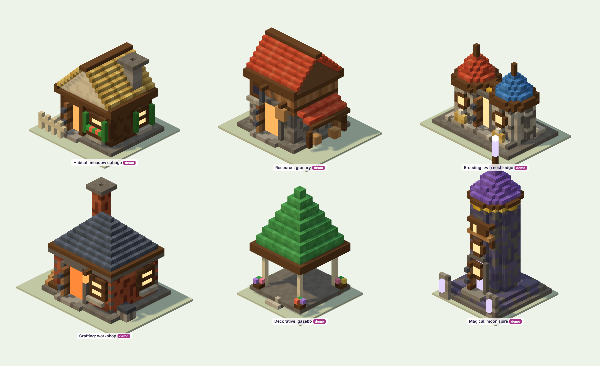
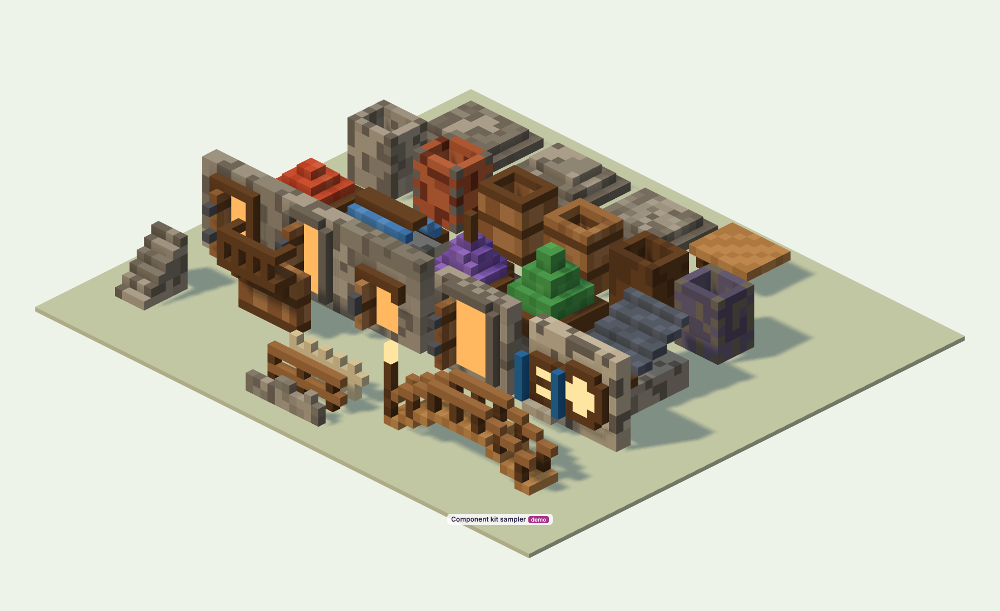

# Aminas — Architectural Construction Standards

*Environment Phase 2, Stage C.* Every building in Aminas shares one construction philosophy and one parts kit
(`src/3d/library/kit.js`), and still has its own identity. The Hatchery is the benchmark.

## 1. The five layers every building has

1. **Base.** A foundation that seats the building in the ground. There are four styles:

| Style | Use |
|---|---|
| `stepped` | important buildings: hatching, magic, breeding |
| `plinth` | homes and workshops |
| `rubble` | rural buildings and ruins |
| `deck` | timber posts, for wet or uneven ground |

   Each has a dark footing course and corner stones. A moss and grass skirt joins it to the meadow.
2. **Walls in layers.** Heavy below and light above: stone or brick ground floor, then a timber-framed, plank or log
   upper storey. A dark beam or string course always marks the change.
3. **A crafted roof.** Shapes are `hip`, `gable-x/z`, `pyramid`, `cone` (round towers) and `shed` (lean-to), each with:
   - shingles in alternating shades;
   - a dark eave course;
   - a ridge cap on gables;
   - an overhang of 1.

   Chimneys, dormers, finials, weathervanes and nests break the roofline.
4. **An identity feature visible from across the island.** One per building, never shared within a category. Examples:
   - the Hatchery's nest and living egg;
   - the forge chimney's ember light;
   - the Tidegate's falling water;
   - the water habitat's tower;
   - the spire's moon crystal.
5. **Human-scale life:**
   - lit windows with sills, glazing bars and shutters;
   - doors with frames and a step;
   - flower boxes, lanterns, banners, crates and barrels.

## 2. Building categories

| Category | Silhouette | Materials | Roof | Signature | Light | In the game today |
|---|---|---|---|---|---|---|
| **Habitats** | low, wide, welcoming | timber over plinth; element-coloured shutters | gable in the element's colour (turf for earth, steep spire for dark) | one element feature (tree, water tower, burrow, chimney, light tower, crystal spire, windmill) | warm windows | 7 habitats (Phase 1.1 silhouettes) |
| **Resource** | practical, with an annex (lean-to, shed, cart) | stone below, plank above | gable or shed | hoist beam, sacks, crates, a sign | few windows, a lit door | Farm, Mine |
| **Breeding** | paired forms joined together | dressed pale stone | soft cones or pyramids in two colours | twin towers or nests | glowing round windows | (none yet: standard and demo only) |
| **Hatching** | tall, central, stepped | ashlar on a stepped platform; timber upper | hip | the egg and its nest, rising above the roof | warm plus egg magic | the Hatchery (benchmark) |
| **Crafting** | strong and smoky | brick with quoins | slate hip | tall chimney, forge glow, anvil, log pile | orange forge light | the Forge |
| **Decorative** | open and graceful | pale stone, painted posts | pyramid or open | planters, hanging lantern | one lantern | lantern, bench, statue, fountain, flower bed |
| **Ancient ruins** | broken versions of their building | the building's own stone | fallen | one clue to the restored building | a faint remnant of its magic | 6 designed ruins (Phase 1.2) |
| **Magical** | tall and luminous | moon-stone (`slateStone`) with gold bands | cone | crystal crown, rune stones, balcony | `MAGIC` hues only | Moonshrine, Tidegate, Reliquary Gate |

*Plate 6 buildings are **demonstrations** assembled only from kit parts. They are not game buildings.*

## 3. The parts kit

All in `kit.js`, all parameterised by material:

| Group | Parts |
|---|---|
| Foundations | `foundation` |
| Walls | `storey` (stone, ashlar, brick, plank, log, timber, slate, rubble, with quoins and bands) |
| Roofs | `roof` (and its `ridge` cap) |
| Openings | `windowZ` and `windowX` (sills, bars, shutters), `roundWindow`, `door` (plank, arched, round, double; ajar, lit, with a step) |
| Vertical elements | `chimney`, `roundTower`, `stairs`, `balcony` |
| Exterior | `fence` (picket, rail, stone), `bridge` (arched, railed, lantern), `platform` |
| Details | `detail.*`: beam ends, brackets, flower box, banner, weathervane, lantern hook, sign, crystal |

Use `at(m, x, y, z)` to place any part or library asset inside a building.

## 4. Keeping buildings individual

- **Vary at least three of these** between any two buildings in the same category: footprint shape, roof shape, roof
  colour, wall material, identity feature, annex.
- **Level growth** is a visible change in the *same* silhouette:

| Level | Change |
|---|---|
| 2 | banners and an extra lit window |
| 3 | gold trim |
| 4 | a flag or finial |
| 5 | a gilded landmark |

  It is never a different building.
- **Rotation** (the gameplay mirror) must keep the identity feature visible.
- Never reuse a whole building with a recolour. Recolours are only for element variants within one plan (habitats),
  and even then each needs its own feature.

## 5. Ruins

A ruin is **the same building, broken**, with one clue to what it will become (see the ruin kit: `tower`, `crack`,
`scatter`, `overgrow`).

- Walls fall to different heights, and the tallest part is a corner or a chimney.
- One fallen element lies on the ground: a drum, a pillar or a lintel.
- Moss in patches, vines down the tallest wall, grass in the cracks.
- A faint remnant of the building's magic or hearth (a dim crystal, a glowing puddle, a light inside the egg).

## 6. Checklist before a building ships

- [ ] Passes the silhouette test at the default zoom.
- [ ] All five layers are present.
- [ ] The identity feature is unique in its category.
- [ ] Only `MAT`, `PAL`, `EL` and `MAGIC` colours are used.
- [ ] The triangle budget holds (under 8k; landmark under 15k); the LOD is reviewed.
- [ ] Levels 1–3 (or 1–5) are reviewed in the viewer; the ruin is designed.
- [ ] It is recorded in the asset register.
