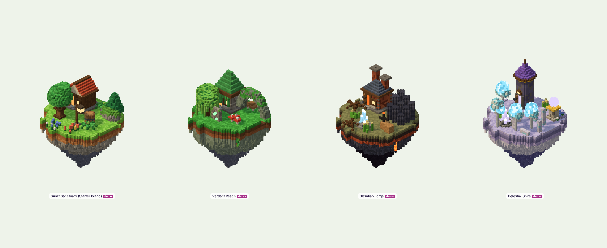

# Aminas — Island Identity Framework

*Environment Phase 2, Stage D.* This is the framework for making every future island unmistakably Aminas, and
unmistakably itself. The profiles live in code in `src/3d/library/biomes.js`.

**Status:**

- **Starter (Sunlit Sanctuary)** is implemented, and it is the benchmark.
- **Verdant Reach, Obsidian Forge and Celestial Spire** are **specifications only**. They are demonstrated by small
  vignettes in the library viewer (plate 10), which are **not** islands in the game. No new island was implemented.

## 1. What stays the same everywhere (the Aminas signature)

These rules never change between islands:

- the voxel scales;
- the construction method (layers, AO, face shading, glow discipline);
- the camera;
- floating islands with a draped rim, layered strata and a tapering root;
- buildings with all five layers;
- magic in `MAGIC` hues;
- hearth light warm.

A player should recognise the game from any single screenshot.

## 2. What each island changes: eight axes

| Axis | Defines | Changed through |
|---|---|---|
| **Climate** | temperature, humidity, season feel | vegetation set, particles, haze, water amount |
| **Geology** | the rock the island is made of | `pal.stone/dark/deep/clay`, signature formations (arches, basalt, monoliths, terraces) |
| **Vegetation** | species and density | weighted species list; grove types; ground cover |
| **Architecture** | the building tradition of its people | wall kind, roof shape and colour, foundation style, signature component |
| **Atmosphere** | sky, haze, clouds, particles | backdrop sky gradient, haze colour, particle type and colour |
| **Light** | time of day and mood | `sun`, `sunI`, hemisphere `sky` and `ground` |
| **Decoration** | the props of daily life | prop set (anvils and carts, rune stones and totems, orbs and obelisks) |
| **Decay and history** | how old, how ruined, by what | `decay` 0–1 (ruin ratio, moss and vines), a one-line history that every ruin must support |

## 3. The four profiles

| | Sunlit Sanctuary (Starter) | Verdant Reach | Obsidian Forge | Celestial Spire |
|---|---|---|---|---|
| Climate | temperate spring meadow | warm, humid jungle terraces | hot volcanic highland | thin cold air above clouds |
| Geology | earth, orange clay, grey stone, standing stones | mossy green-grey terraces, arches, plunge pools, caves | black basalt columns, obsidian, lava seams | pale moon-stone shelves, monolith rings, crystals |
| Vegetation | oak, pine, birch, blossom groves; meadows | willows, giant ferns, glowcaps, vines, hanging moss | charred trees, ash grass, roots | crystalwood, sparse pale grass |
| Architecture | timber and plaster over pale stone; red, blue and green tiles | vine-wrapped mossy temples; stepped green-gold roofs | brick and iron forges; slate hips; twin chimneys | moon-stone towers; purple cones; gold bands |
| Atmosphere | blue sky, white clouds, pollen | teal sky, valley mist, fireflies | violet-red dusk, smoke, embers | night-blue sky, cloud sea, stars |
| Light | late-morning warm sun | green-gold, filtered | red-gold, long shadows, ember glow | cool moonlight, warm windows |
| Decoration | lanterns, benches, fountains | rune stones, columns, rope bridges | anvils, ore carts, ember pylons | orb pedestals, obelisks |
| Decay | 0.3, being restored | 0.7, swallowed by jungle | 0.5, a forge over an older forge | 0.15, ancient and untouched |

The full values are in `biomes.js`. The vignettes use the palettes, vegetation weights, wall kinds and roof colours
directly from these profiles.

## 4. Rules for a new island

1. **Write the history first** (one line). Every ruin, prop and building must support it.
2. **Change at least five of the eight axes.** Colour alone is not an identity: plate 10 differs in geology,
   vegetation, architecture *and* light.
3. **Pick one signature formation and one signature building component** that no other island uses.
4. **Keep the separation rule:** the ground, trees, buildings and paths must still separate by hue and value. Check
   with the material board recoloured in the island palette.
5. **Reuse construction, not models.**
   - Build the island's buildings from `kit.js` with its own `MAT` choices.
   - Add new species to the vegetation library rather than recolouring.
6. **Budget:** the same triangle and draw-call limits as the Starter Island (see the art bible, section 16).

## 5. Implementation path (future milestones)

To make an island use a profile, `island3d.js` would read the profile in four places: `buildTerrain` (palette and
root shape), the scenery (vegetation weights), `LIGHT` (light) and the backdrop (atmosphere). The structure is ready;
wiring it up belongs to a new-island milestone and was deliberately not done here.
